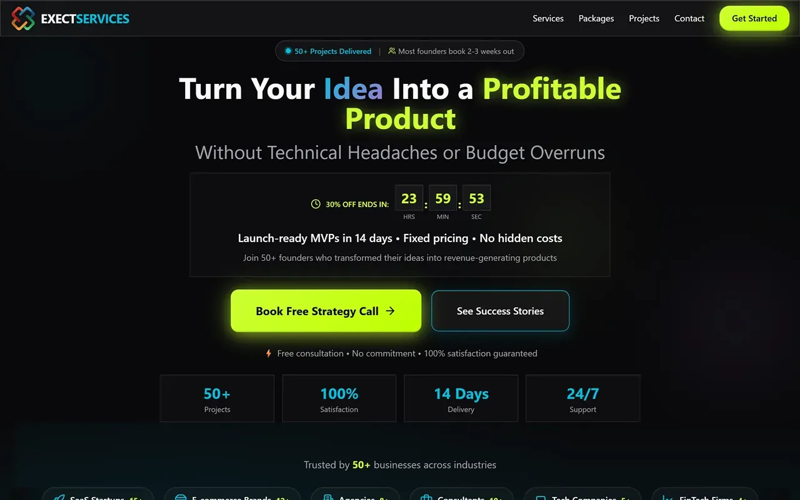

# EXECT Services

**An interactive agency portfolio built around considered motion and visual presentation.**

      

## Overview

An agency portfolio presenting design and full-stack development capabilities through an interactive web experience. The published project combines HTML, CSS and JavaScript with GSAP and Three.js visual interactions.

## The challenge

The agency needed to stand out and showcase its capabilities in a crowded market.

## The solution

A visually striking, high-performance portfolio with advanced animation and a sleek dark design.

## Key features

- Agency portfolio presentation
- GSAP interface motion
- Three.js visual interactions

## Tech stack

HTML5 · CSS3 · JavaScript · GSAP · Three.js

## Privacy

Client names and records are confidential. Every screen in this repository uses sample data, and source code that belongs to the client is not published.

## Links

- Case study on Lexvaxa: https://lexvaxa.com/work/exect-services
- Built by **Ch Muhammad Samiullah** ([GitHub](https://github.com/samiullah156-creator)) at [Lexvaxa](https://lexvaxa.com)
